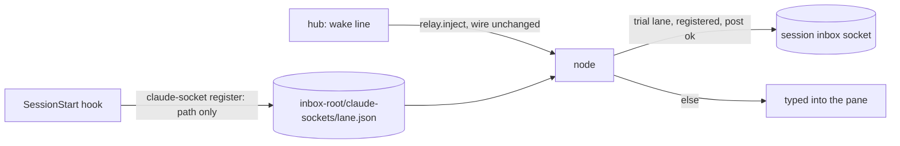

# Claude sessions: job names and the wake line as a session message

hk 4258. Operator decisions 139 and 141. Claude Code 2.1.322, checked on
home-desktop (Linux) on 2026-11-12.

## Session names

`panewire spawn` and `panewire delegate --headless` start every Claude session
with `--name <job id>`, so `ListAgents`, `/list-agents` and `@name` address a
fleet seat by the id the fleet already uses. Only `claude` takes the flag; every
other harness argv is unchanged (`withSessionName` in `internal/fleet/herdr.go`).

panewire starts no design, desk or policy session: those are operator-opened,
and the operator names them with `/rename <lane>`. The job id is therefore the
only name panewire sets.

`--name` retitles the composer's top edge (`──── job-a ─`). The landing proof
already accepts a titled edge (hk 2904); a test covers it
(`TestClaudeLandingProofWithTitledComposer`). herdr agent detection reads the
process name, which `--name` does not change.

## The trial: the wake line as a session message

Off by default. For the lanes named in the node daemon's
`PANEWIRE_CLAUDE_SESSION_MESSAGE_LANES` (comma separated, for example
`routing-policy`), the node posts the lane's inbox wake line

    [inbox] <lane>: N unread (most urgent: <kind>) | panewire inbox list --lane <lane>

to the lane's Claude Code session instead of typing it into the pane. The
session message carries the sender prefix `panewire-hub: ` before the line;
the line typed into the pane has no prefix. The text is otherwise unchanged
and the hub inbox stays the record. The line's kind is documented in
[quiet-delivery.md](quiet-delivery.md#inbox-only-lanes) (`order` displays as
`order`, ranked as `decision`; hk 4458). Nothing else changes: every
other lane, every other line and every non-Claude harness is typed as before,
and so is the lane's own line whenever the post cannot be made.



### Registration

The session's `SessionStart` hook records the session's socket path. Claude Code
exports `CLAUDE_CODE_MESSAGING_SOCKET` before any hook runs. Host configuration
(not part of this repository):

```json
{"hooks":{"SessionStart":[{"hooks":[{"type":"command",
  "command":"panewire claude-socket register --lane routing-policy"}]}]}}
```

`panewire claude-socket register [--lane L] [--inbox-root DIR]` writes
`<inbox-root>/claude-sockets/<lane>.json` (mode 0600, replaced atomically) with
the lane, the herdr pane the session runs in (`--pane`, else `HERDR_PANE_ID`,
which herdr sets in the pane and hooks inherit), the path and a time. A
registration with no pane is refused.

The node posts only when the registered pane is the pane the hub routed the wake
line to. A lane moved to another pane while its old session is still alive, or a
host-wide hook registering a different session, therefore falls back to typing
into the routed pane (`reason=other_pane`) instead of reaching the wrong
session; the new session's own hook run takes the registration over. It prints nothing on success, since a
`SessionStart` hook's stdout becomes session context. It refuses a path that is
not absolute, clean and a socket.

### Authentication without storing the token

The node never reads or stores `CLAUDE_CODE_MESSAGING_TOKEN`. On macOS and
Linux the socket accepts a connection without the auth line (Claude Code
documentation, "The session's inbox socket") and only the session's operating
system user can connect. The node daemon runs as that user. Observed: posts
from a separate process with no auth line were accepted by sessions in three
permission modes. On native Windows the auth line is required, so the trial does
not apply there.

The post is one JSON line, the form Claude Code's own `--messaging-socket-path`
banner prints: `{"type":"user","message":{"role":"user","content":"<line>"}}`.
The node writes it, half-closes and waits up to 5 s for the session to close its
end (not required for success). The socket path and the text are never logged.

### What a post from the node daemon does

The daemon is not a child of the session and does not say which permission mode
it is in (the wire has an undocumented `from_mode` of `bypass` or `prompting`;
the node does not set it, because it is neither). Claude Code then treats the
post as a message that asserts no permission class. Observed on 2.1.322, same
host, posts from a separate process (`reply` = what the connection returned):

| Receiving session | `crossSessionInbound` | Result |
|---|---|---|
| `auto` mode | unset | Delivered at once; the idle session started a turn; `reply` empty |
| `default` (manual) mode | unset | Delivered at once; same |
| `default` mode, operator had a half-typed draft | unset | Delivered; turn ran; the draft stayed in the input box untouched |
| `--dangerously-skip-permissions` | unset | Held: an approval dialog (sender shown as "an unidentified session [verified pid …]", reason "the sender did not attest its permission mode and this session bypasses prompts"); not delivered. Choosing Deny dropped it. The poster's connection got no byte, before or after |
| `--dangerously-skip-permissions` | `accept` (via `--settings`) | Delivered at once |

Consequences:

- **`crossSessionInbound`** need not be set for a session that prompts for
  permissions (auto, default, acceptEdits, dontAsk). It must be `accept` for a
  session that bypasses prompts (`bypassPermissions`, or plan mode with bypass
  available), or every post waits for an approval nobody sees; unanswered, it is
  dropped after `dialogExpiry` (5 minutes by default). panewire-spawned Claude
  seats run with `--dangerously-skip-permissions`, so they would need
  `--settings '{"crossSessionInbound":"accept"}'` at launch before this path
  could serve them.
- **While the operator types**: no mixing. The message is not input; it is a
  separate turn, shown as `Another Claude session sent a message:` with the
  text, and the draft is kept.
- **An idle session**: starts a turn with the message (observed). A busy session
  reads it between tool calls (documented; the one busy run here finished its
  turn before the post, so this case was not exercised).
- **Authority**: Claude Code tells the receiver the message is not the user, that
  it cannot approve a prompt or change settings, and that its own permission
  rules apply. The wake line keeps its meaning as a pointer to the inbox.
- The received pane shows the message under a `❯` row. Screen scanners that read
  `❯` rows as typed turns (the landing proof, the relay transcript-echo proof)
  would see it; the trial lane is not a spawned seat, so nothing reads it today.

### The delivery stage panewire reports

Only **`reached_socket`**: the line was completely written to the session's socket.
A live session closes its end once it has read the line, but a session that
keeps the connection open past the 5 s wait still counts, so the stage is not
proof that the session read it. It is logged by the node (`stage=reached_socket`), not
written to the hub inbox. Claude Code gives a poster no acknowledgement: a
message held for approval, denied, expired, dropped (rate limit, a repeated
identical message, a full queue of 50) or simply unread by Claude looks like a
delivered one to the node. A held message is observed to return nothing even
after Deny. The `lane_inbox` stages (`typed`, `delivered`, …) are not set for a
session-message wake, and the wake line is not a durable row, so the hub inbox
and `panewire inbox status` remain the record of what the lane has and has not
read.

Fallbacks to the typed line, each logged as `stage=fell_back_to_typed` with a
reason (`not_registered`, `registration_invalid`, `other_pane`, `socket_gone`, `timeout`,
`post_failed`): no registration; a registration that is not a socket or names
another lane; a socket that no longer exists or refuses the connection; a failed
write; a read error after the write.

### Not covered

- The idle-wake line (`docs/idle-wake.md`) and every other typed line keep their
  path.
- A second Claude session started in the same pane without the hook is not
  detected until the first one's socket is gone (then the line is typed).
- Claude Code's `--messaging-socket-path` flag (in the binary, not in
  `claude --help`) would give a panewire-started session a path the node already
  knows, with no hook. It is undocumented and not used.

## `SendMessage` with `notify_when_idle`

Documented, not exercised here. It lets the Claude in a main conversation ask
one same-machine session (v2.1.236 or later on both sides) for a single notice
when that session next goes idle or exits, at no cost to the watched session;
the subscription is dropped after 12 hours. It could replace a *Claude's* bounded
wait on another Claude session on the same machine (`panewire inbox wait`,
`panewire wait --agent ID --status idle`).

panewire should not offer it as a command or a node feature: only the Claude
conversation itself can subscribe (the node is not a session; a subagent or a
session beyond the machine is refused), it works only Claude to Claude, and it
carries no record. It is a shortcut a Claude lane may use in its own session;
`panewire wait` stays the form that works for every harness and survives a
session restart.
