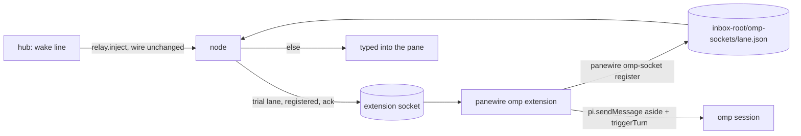

# Session-message receivers: codex and omp

hk 4261. Follows the Claude trial ([claude-session-message.md](claude-session-message.md),
hk 4258). Operator decisions 143 and 144: no Command Code receiver (it runs
through omp), `devin` and `agy` keep the typed line, no Rust.

For the lanes a harness's switch names, the node delivers the lane's inbox wake
line

    [inbox] <lane>: N unread (most urgent: <kind>) | panewire inbox list --lane <lane>

to the lane's own session instead of typing it into the pane. The hub's wire is
unchanged; the line gets the sender prefix `panewire-hub: ` as for Claude; the
hub inbox stays the record. A lane is served by the first harness whose list
names it (claude, codex, omp), so one line is never delivered twice.

| Harness | Switch (node daemon env) | Registration (`<inbox-root>/…/<lane>.json`) | Delivery | Stage reported |
|---|---|---|---|---|
| claude | `PANEWIRE_CLAUDE_SESSION_MESSAGE_LANES` | `claude-sockets/` — `panewire claude-socket register` | JSON line to the session's inbox socket | `reached_socket` |
| codex | `PANEWIRE_CODEX_SESSION_MESSAGE_LANES` | `codex-threads/` — `panewire codex-thread register` | `codex queue --thread <id> --message=<line>` | `queued` |
| omp | `PANEWIRE_OMP_SESSION_MESSAGE_LANES` | `omp-sockets/` — `panewire omp-socket register` | JSON line to the panewire extension, which calls `pi.sendMessage` | `acked` |

Every registration is bound to the herdr pane the session runs in (`--pane`, else
`HERDR_PANE_ID`); the node delivers only when that is the pane the hub routed the
wake line to (`reason=other_pane` otherwise). Files are mode 0600, replaced
atomically, and hold no token. Every miss falls back to the typed line, logged by
the node as `stage=fell_back_to_typed` with a `reason` and a `harness`; the
thread id, the socket path and the line are never logged. `panewire` stages are
claims about how far the line got, never that the model read it.

## codex

### What `codex queue` does (checked on codex-cli 0.167.0, Linux, 2026-11-18)

`codex queue --thread <uuid|session name> --message <text>` writes the message to
the thread's queue in `queue_1.sqlite` of the session's `CODEX_HOME`. Observed on
a throwaway `CODEX_HOME` with its own app-server and a thread of its own (no
other lane's session was addressed, and no credential was used):

| Case | Result |
|---|---|
| Thread loaded by an app-server, idle | `Queued message <id> for thread <id>.`, exit 0. The thread emitted `thread/status/changed: active`, `turn/started`, then a `userMessage` item whose text was exactly the queued text. The turn then failed with 401 because the throwaway home had no login; that is the model call, not the queue |
| Thread unknown | `Error: No active session found matching '<x>'.`, exit 1 |
| Thread known, repeated | Each call queues one more message and exits 0 |

So an idle thread starts a turn from a queued message at once, and the session
sees a plain user message: unlike Claude Code, codex does not mark the sender, so
the `panewire-hub: ` prefix is the only provenance. This is the same authority a
typed line has.

A plain `codex` TUI (what `panewire spawn` starts: `codex --yolo -m … -c …`) has
`queue_1.sqlite` open in its `CODEX_HOME` and no connection to the shared
app-server daemon (`codex app-server daemon`). Whether such a TUI picks up a line
`codex queue` wrote from another process, and when (idle versus mid-turn, the
"steer" versus "queue" behaviour), is **not proven here**: proving it takes a
queue post to a live seat, which this change does not do. It is the first thing
the trial checks (below). `turn/steer` exists in the app-server protocol, but
`codex queue` is the only documented command-line entry point and the one used.

### Registration

Codex's `SessionStart` hook receives JSON on stdin that names the session
(`session_id` is the thread id). Host configuration, beside herdr's own hook in
`~/.codex/hooks.json` (not part of this repository; Codex asks the host owner to
review a new hook once):

```json
{"hooks":{"SessionStart":[{"hooks":[{"type":"command",
  "command":"panewire codex-thread register --lane routing-policy"}]}]}}
```

`panewire codex-thread register [--lane L] [--pane P] [--thread ID] [--inbox-root DIR]`
reads the thread id from the hook input, or from `--thread`, and records it with
the lane, the pane, a time and the `CODEX_HOME` in the hook's environment when it
is set. It prints nothing on success (a hook's stdout can become session
context). It refuses an id that is not a UUID, so a registration can never put a
flag or a name in `codex queue`'s argv.

`CODEX_THREAD_ID` is deliberately not read: a nested `codex` session inherits its
parent's value, and registering that would address the parent. The node runs
`codex queue` with the recorded `CODEX_HOME`, so a seat started with its own
home is queued in its own store. The node daemon must be able to run `codex`
(on its `PATH`) as the same operating-system user.

### Not covered

The idle-wake line and every other typed line keep their path. A lane whose
session was restarted keeps the old registration until the new session's hook
runs; a queue to a thread that is no longer active exits 1 and the line is typed.

## omp

omp has no inbox socket. Its extension API gives `pi.sendMessage(message,
{triggerTurn, deliverAs})`: `deliverAs: "aside"` injects the message at the next
agent step boundary without interrupting the tool batch in flight, and starts a
turn when the session is idle. panewire ships the extension that exposes it to the
node: [docs/examples/omp-session-message.ts](examples/omp-session-message.ts).



### Install and registration

Copy the extension to `~/.omp/agent/extensions/` (next to herdr's). It does
nothing unless `PANEWIRE_LANE` and `HERDR_PANE_ID` are set and the process is not
a nested `omp` (`OMPCODE=1`). On `session_start` it binds a socket in a private
directory under `os.tmpdir()` (override: `PANEWIRE_OMP_SOCKET_DIR`), runs
`panewire omp-socket register --lane L --pane P --socket PATH`, and removes the
socket on `session_shutdown`. If registration fails it removes the socket again.

### Wire

One JSON line each way. Node to extension:
`{"type":"panewire.message","text":"panewire-hub: [inbox] …"}`. The extension calls

```ts
pi.sendMessage({ customType: "panewire-hub", content: text, display: true },
               { triggerTurn: true, deliverAs: "aside" })
```

and only then answers `{"ok":true}`; any other answer (`{"ok":false}`, a closed
connection, silence for 5 s) is `reason=no_ack` or `reason=timeout` and the line
is typed. The extension is therefore the evidence for the `acked` stage:
`pi.sendMessage` returned for this line. A line the node typed after a lost ack
may arrive twice; the wake line is a pointer to the inbox, so a repeat is
harmless.

## Tests

`codex_session_message_test.go`, `omp_session_message_test.go` and the shared
`claude_session_message_test.go`, all with fakes: a fake `codex queue` function
and a fake `codex` executable on `PATH` (argv, `CODEX_HOME`, exit status), a fake
omp extension socket, and — when `bun` is installed — the shipped extension
itself run under bun with a fake `pi`, registering through the real `panewire`
binary. No test touches a live session.

## The trial procedure (a later step, run by panewire-design)

Prerequisites: a lane that is operator-opened or a disposable test seat, never a
worker mid-job; its node daemon started with the harness's switch naming only that
lane; the hook (codex) or extension (omp) installed on that host.

1. Register. Start the session, then read `<inbox-root>/<dir>/<lane>.json`: the
   lane, the pane and the thread or socket must match the session. Check mode 0600.
2. Idle delivery. Add an inbox item above `info` for the lane so the hub sends the
   wake line. Expect the session to start a turn whose first message is
   `panewire-hub: [inbox] <lane>: …`, the node log line `stage=queued` (codex) or
   `stage=acked` (omp), and nothing typed into the pane.
3. Busy delivery. While the session works a long command, send another wake line.
   Record when it arrives: codex (queue versus steer: after the turn, or at the
   next boundary) and omp (`aside`: at the next step boundary, without cutting the
   tool batch). The trial exists to settle the codex answer: if a plain TUI does
   not pick the queue up while idle, stop and report `codex queue` as unusable for
   spawned seats; the fallback to typing already covers it.
4. Operator draft. Type half a line in the composer and repeat step 2. The draft
   must stay untouched (Claude's behaviour; codex and omp must be checked).
5. Fallbacks. Move the lane to another pane (`reason=other_pane`), stop the
   session (`queue_failed` for codex, `socket_gone` for omp) and clear the
   registration (`not_registered`): each must type the line exactly once.
6. Record per harness: what the receiving model did with the line, whether it
   treated it as the operator or as the hub, and any duplicate or lost line.
   Turn the switch off again afterwards; nothing else changes.
